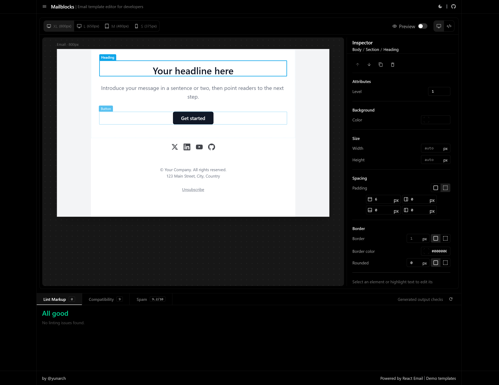

<div align="center">


# Mailblocks

[](https://yunarch.github.io/mailblocks/)
[](https://github.com/yunarch/mailblocks/actions/workflows/ci.yaml)
[](LICENSE.md)

**Build an email visually, then copy production-ready HTML.**
<br />
Powered by [React Email](https://react.email/).

[Overview](#overview) • [Why](#why) • [Features](#features) • [Getting started](#getting-started) • [Development](#development)



</div>

## Overview

Mailblocks is a browser-based email template editor for developers. Start from a blank starter or one of the [React Email demo templates](https://demo.react.email/), edit the content visually, and get email-ready HTML along with instant feedback on markup issues, email-client support, and spam signals.

Everything runs client-side: there's no backend, account, or sign-up.

## Why

Building an email template that looks good everywhere is hard, because email clients don't follow modern web standards:

- **Every client renders differently:** Outlook on Windows uses Word's rendering engine, Gmail strips styles that aren't inline, and Apple Mail supports features that break elsewhere.
- **Outdated coding rules:** No Flexbox, no Grid, no external stylesheets. Layouts are still built with tables and inline styles.
- **Mobile and desktop:** Roughly half of all emails are opened on phones, so multi-column layouts have to stack cleanly on small screens.
- **Endless testing:** Checking a single template across clients and devices can take hours.

Mailblocks takes care of that complexity. Design the email visually, check how it holds up, and copy the HTML. Then use it to create the template in your backend or email service.

## Features

- **Visual editor:** Edit content inline, insert blocks with `/` slash commands, and fine-tune attributes, colors, dimensions, spacing, and borders from the inspector.
- **Block management:** Reorder, duplicate, or remove blocks to shape your layout.
- **Ready-made templates:** Load React Email demo templates as editable HTML, browsable by category.
- **Responsive previews:** Switch between XL (800px), L (650px), M (480px), and S (375px) viewports, toggle between the editor and the rendered output, and see the email inside a generic desktop or mobile mail client.
- **Generated HTML:** Inspect and copy the produced HTML without leaving the editor.
- **Markup linting:** Catch common issues in the generated markup as you edit, with code locations.
- **Email-client compatibility:** Check the HTML and CSS features you use against the email clients you select, based on [caniemail](https://www.caniemail.com/) data.
- **Spam checks:** Get a heuristic score with detailed findings, such as image-to-text ratio, missing unsubscribe link, link shorteners, mismatched link text, spammy phrases, and messages large enough to be clipped by Gmail (over 102 KB).

> [!WARNING]
> Compatibility checks and spam scores are guidance, not guarantees of rendering accuracy or inbox placement.

## Getting started

### Prerequisites

- **Bun**: `>=1.3.9` A package manager that is used to install dependencies and manage scripts in this repository. You can download Bun from the official website: [https://bun.sh/](https://bun.sh/).

### Run locally

```sh
bun install
bun run dev
```

## Development

| Command                 | Description                                   |
| ----------------------- | --------------------------------------------- |
| `bun run dev`           | Start the Vite development server.            |
| `bun run build`         | Create a production build in `dist/`.         |
| `bun run preview`       | Preview the production build locally.         |
| `bun run lint`          | Run ESLint and TypeScript checks.             |
| `bun run lint:code:fix` | Apply automatic ESLint fixes.                 |
| `bun run format`        | Check formatting with oxfmt.                  |
| `bun run format:fix`    | Format files with oxfmt.                      |
| `bun run clean`         | Remove build output and caches.               |
| `bun run gen:templates` | Sync templates from the React Email demo app. |

### Testing

This project has automated tests in place to help ensure that the codebase is stable and functioning as expected and uses [Vitest](https://vitest.dev/) as its automated testing framework.

We have the next types of tests:

- **Standard Unit Tests** (`*.test.ts(x)`) - For testing utility functions, services, etc, non-UI logic.
- **Browser Mode Unit Tests** (`*.browser.test.ts(x)`) - For tests that require DOM access.

```sh
# Run all the tests
bun run tests

# Run all the tests in watch mode
bun run tests:watch

# Run only standard tests
bun run tests:standard

# Run only browser mode tests
bun run tests:browser
```

See the [testing guide](docs/testing.md) for detailed instructions on how to test.

> [!NOTE]
> In order to run `browser mode tests` you need to install browsers. It should be done automatically. But if you encounter any issues, you can manually install them with the following command:
>
> ```sh
> bunx playwright install
> ```

### Updating templates

The bundled templates are generated from the [React Email demo emails](https://github.com/resend/react-email/tree/canary/apps/demo/emails). Running `bun run gen:templates` downloads them, renders each one to HTML, and regenerates `src/utils/templates.ts`.

> [!NOTE]
> `src/utils/templates.ts` is generated. Don't edit it manually; rerun the sync script instead.

### Project structure

```text
src/
├── components/   # App panels: editor, linter, templates drawer, header and footer
├── extensions/   # Editor extensions: blocks, slash commands, block actions
├── utils/        # Markup, compatibility and spam linters, generated templates
├── ui/           # Reusable UI primitives
├── hooks/        # Shared React hooks
├── providers/    # App context
├── styles/       # Global styles
└── types/        # Shared types (viewports, linter results, templates)
scripts/          # Template sync script
```
